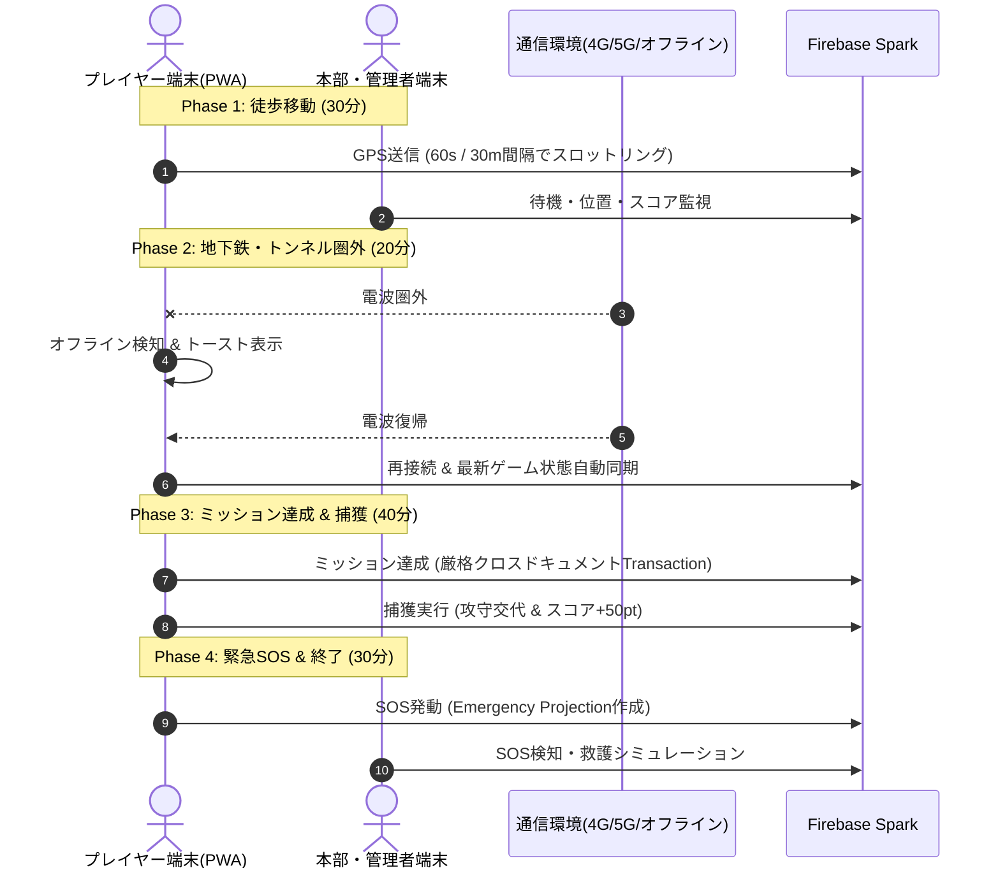

# Transit Tag Game 現場フィールドテスト & 運用検証ランブック

本ドキュメントは、実際の鉄道・交通移動を伴う鬼ごっこイベント本番を想定した、実機（iOS / Android）による耐久運用試験の手順、検証項目、および記録用シートです。

---

## 1. 目的と検証基準

| 項目 | 目標基準 | 判定方法 |
| :--- | :--- | :--- |
| **連続稼働時間** | 最低2時間の移動中にブラウザクラッシュやPWA切断が発生しないこと | 実機ログ & 画面監視 |
| **バッテリー消費** | 2時間で消費率 **25%以内**（位置情報スロットリング効果の確認） | OS設定のバッテリー使用状況 |
| **GPS精度と追従性** | 移動時（電車・徒歩）にスロットリング（60秒 / 30m移動）が正常に機能すること | 管理者マップ画面での軌跡確認 |
| **電波途絶耐性** | 地下鉄やトンネルでの電波圏外から圏内復帰時に自動再接続されること | トンネル通過テスト |
| **Wake Lock維持** | 画面消灯せず、地図と鬼接近アラートが常時視認可能であること | 目視確認 |
| **Firebase無料枠** | 2時間のゲーム（10人参加想定）でFirestore書き込みが **2,500回以内**（Sparkプラン1日20,000回上限の12.5%以下）に収まること | 管理画面テレメトリ |

---

## 2. 事前準備（Pre-Flight Checklist）

- [ ] **端末充電**: 検証用スマートフォンを100%まで充電。
- [ ] **PWAインストール**:
  - **iOS**: Safariでアクセス →「共有」→「ホーム画面に追加」
  - **Android**: Chromeでアクセス →「インストール」または「ホーム画面に追加」
- [ ] **位置情報権限**:
  - ブラウザ/PWAの位置情報利用を「常に許可」または「アプリ使用中のみ許可（正確な位置情報ON）」に設定。
- [ ] **管理者アカウントの確認**:
  - `/admins/{uid}` に登録済みの管理者アカウントでログイン可能であることを確認。
- [ ] **初期セッションの作成**:
  - 管理者ダッシュボードより `PRE_GAME` から `DAY1_ACTIVE` へフェーズ遷移を実施。

---

## 3. 実機検証シナリオ（2時間耐久テスト）



### ステップ 1: 静止時・徒歩移動（30分）
1. 端末をPWAとして起動し、ログイン・チーム参加（AまたはB）を行う。
2. 静止状態を5分間維持し、GPS更新が抑制（スキップ）されていることを確認。
3. 徒歩で約500m移動し、30m以上の移動かつ60秒経過時にのみ座標が送信されることを確認。

### ステップ 2: 電車移動 & 地下・トンネル電波断（20分）
1. 電車（JR/地下鉄）に乗車。
2. トンネル内または機内モードによる電波遮断（約3分間）をシミュレート。
3. 圏外時にエラー画面でクラッシュせず、「接続中...」等の状態を保持することを確認。
4. 圏内復帰後、Firestore Realtimeリスナーが即座に同期を再開することを確認。

### ステップ 3: ゲームプレイ整合性テスト（40分）
1. **ミッション達成**:
   - ミッション画面より指定ミッションを報告。
   - 自分のスコアおよびチームスコアが正しく同一トランザクションで加算されることを確認。
   - 二重報告がFirestore Security Rulesおよびクライアント側で確実に弾かれることを確認。
2. **無敵カード発動**:
   - 逃走者役時に無敵カードを発動。
   - 10分間のタイマーが表示され、鬼からの捕獲が無効化されることを確認。
3. **捕獲（攻守交代）**:
   - 鬼役が逃走者に接近し「捕獲ボタン」を実行。
   - 攻守役割が反転し、捕獲された側が待機（60分）へ移行することを確認。

### ステップ 4: セーフティ & SOSテスト（30分）
1. 「SOS / 緊急事態」ボタンをタップ。
2. 理由（急病・トラブル）を選択して送信。
3. プレイヤー状態が `EMERGENCY` に遷移し、管理者ダッシュボードにのみ緊急座標がリアルタイム表示されることを確認。
4. 他の一般参加者の画面からは当該プレイヤーの位置が完全不可視であることを確認。

---

## 4. フィールドテスト記録シート（記入用テンプレート）

```markdown
### テスト実施記録
- 実施日時: 2026年___月___日 ___:___ 〜 ___:___ (所要時間: ___分)
- 移動経路: ________駅 〜 ________駅 (JR / 地下鉄 / 徒歩)
- 天候: ________ (気温: ___℃)

### 使用端末
| 端末名 | OSバージョン | ブラウザ/PWA | 担当役割 | 開始時バッテリー | 終了時バッテリー | 消費率 |
| :--- | :--- | :--- | :--- | :--- | :--- | :--- |
| iPhone 15 | iOS 18.__ | Safari PWA | 逃走者 | 100% | ___% | ___% |
| Pixel 8 | Android 15 | Chrome PWA | 鬼 | 100% | ___% | ___% |
| iPad Pro | iPadOS 18.__ | Safari | 管理本部 | 100% | ___% | ___% |

### 機能別検証結果
- [ ] PWAホーム画面追加・フルスクリーン起動: ( 正常 / 異常: ________________ )
- [ ] Wake Lock (画面常時点灯): ( 維持された / 消灯した )
- [ ] GPS追従性 (スロットリング): ( 良好 / 遅延あり / 異常 )
- [ ] 地下鉄トンネル復帰時の再同期: ( 即座に復帰 / リロード必要 )
- [ ] ミッション達成 & スコア加算: ( 正常 / 異常: ________________ )
- [ ] 捕獲処理 (攻守交代): ( 正常 / 異常: ________________ )
- [ ] SOS (緊急時座標共有): ( 正常 / 異常: ________________ )

### 課題・改善点メモ
1. 
2. 
```
